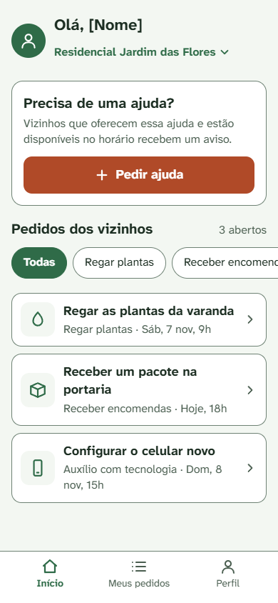
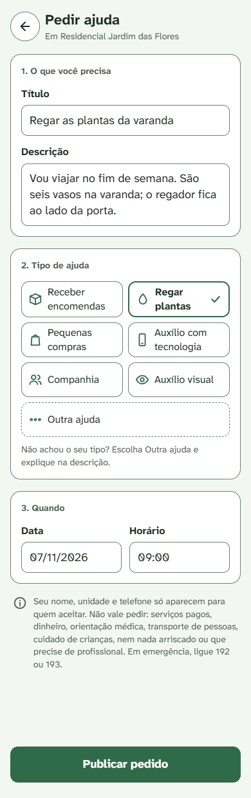
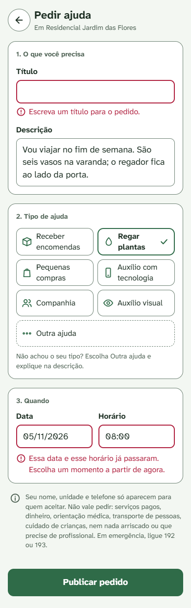
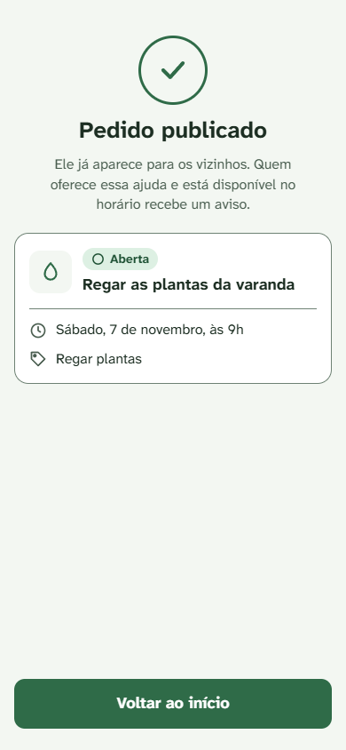
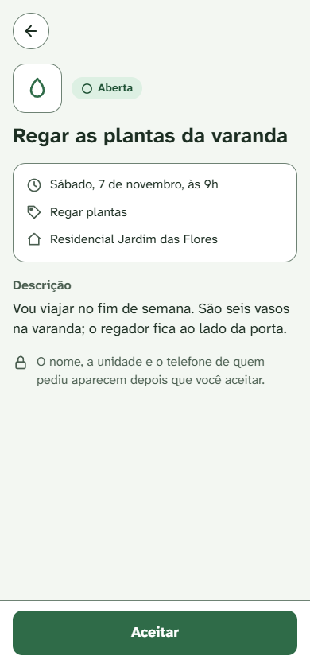
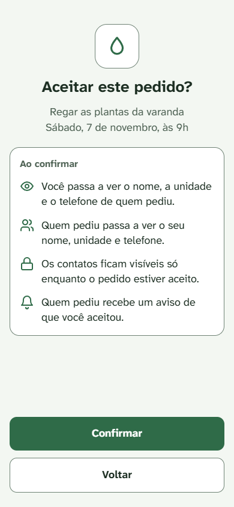
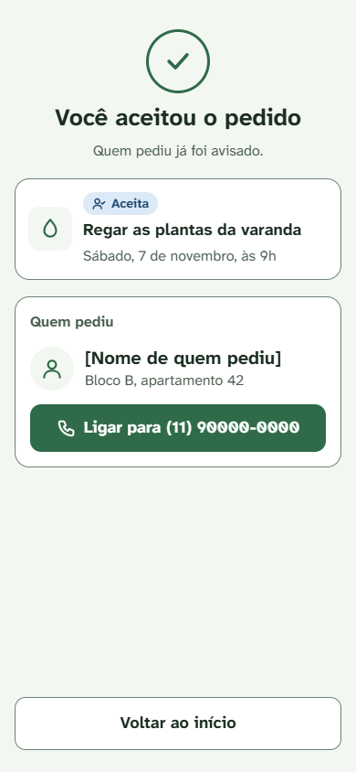
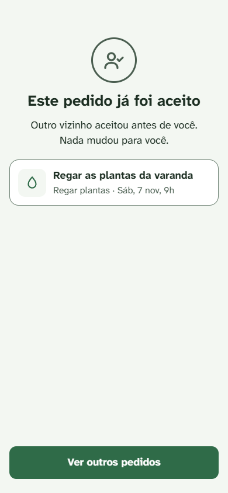
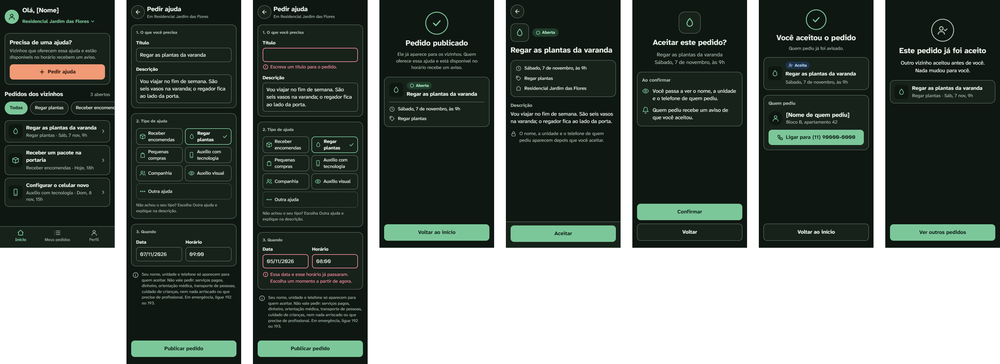

# Mockups: criar e aceitar solicitação

- Origem: Issue #36. Telas do UC-01 (criar) e do UC-02 (aceitar), mais a tela inicial com o seletor de comunidade.
- Ferramenta: tipo Design do Claude.ai. Esta pasta guarda as imagens da versão aprovada em 05/11/2026. As imagens 06 e 09 foram atualizadas em 06/11/2026, na Issue #40 (DC-09 e DC-10).
- Fontes: `docs/casos-de-uso/ciclo-da-solicitacao.md`, `docs/specs/usabilidade.md`, `docs/design/identidade-visual.md` e `docs/adr/ADR-34-categoria-outra-e-nome.md`.
- Tamanho das telas: 390 px de largura. A largura de 320 px (RNF-US-06) é conferida na tela real.
- Todo nome entre colchetes, como [Nome], marca onde entra o nome real. A comunidade e os contatos das telas são fictícios.

## Telas

| # | Tela | Caso de uso | Cláusulas e decisões |
|---|---|---|---|
| 1 | Tela inicial | UC-01, passo 1 (comunidade); UC-02, passo 1 (lista) | RF22; RC-10 e DC-08 (lista sem nome, unidade nem telefone); RNF-US-02 (lista já na tela inicial); DT-08 (o próprio pedido não aparece) |
| 2 | Pedir ajuda | UC-01, passos 2 e 3 | DC-07 (Outra ajuda); ADR-34 (o que não pode ser pedido); RNF-US-07, RNF-US-08 |
| 3 | Pedir ajuda com erros | UC-01, E1 e E3 | RNF-US-10 |
| 4 | Pedido publicado | UC-01, passo 7 | DC-01 (quem recebe o aviso) |
| 5 | Detalhe do pedido | UC-02, passos 2 e 3 | DC-08 (sem nome, unidade nem telefone antes do aceite) |
| 6 | Confirmar o aceite | UC-02, passos 4 e 5; A3 (Voltar) | RF-US-01, RF-US-02; DC-09 e DC-10 (o contato do apoiador vai para quem pediu, enquanto o pedido estiver aceito) |
| 7 | Pedido aceito | UC-02, passos 6 a 8 | P-04 e DC-08 (nome, unidade e telefone para o apoiador) |
| 8 | Este pedido já foi aceito | UC-02, E1 | P-01 |
| 9 | Tema escuro | As telas 1 a 8 | RNF-US-03, RNF-US-04 (V2 da identidade visual) |

### 1. Tela inicial

### 2. Pedir ajuda

### 3. Pedir ajuda com erros

### 4. Pedido publicado

### 5. Detalhe do pedido

### 6. Confirmar o aceite

### 7. Pedido aceito

### 8. Este pedido já foi aceito

### 9. Tema escuro

## Contagem de toques

Preencher campos e rolar a tela não contam (DEF-US-02), e a contagem começa com a comunidade já escolhida (DEF-US-03).

| Fluxo | Toques | Limite | Caminho |
|---|---|---|---|
| Criar (RNF-US-01) | 2 | 3 | 1. Pedir ajuda (tela 1) · 2. Publicar pedido (tela 2) |
| Aceitar no webapp (RNF-US-02) | 3 | 3 | 1. Tocar no pedido (tela 1) · 2. Aceitar (tela 5) · 3. Confirmar (tela 6) |
| Aceitar no bot (RNF-US-02) | 2 | 3 | 1. Aceitar · 2. Confirmar, na própria mensagem de aviso. Conferido no catálogo de mensagens do bot (pendente) |

Aceitar no webapp está no limite. Por isso a lista de pedidos abertos fica na tela inicial: se abrir a lista custasse um toque, o RNF-US-02 falharia.

## Conferência contra a spec de usabilidade

| Cláusula | Situação no mockup | Como foi conferido |
|---|---|---|
| RF-US-01, RF-US-02 | Atendido no webapp | Tela 6: confirmação com o aviso; Voltar leva de volta à tela 5 sem mudar nada. No bot: catálogo de mensagens (pendente) |
| RNF-US-01 | Atendido | Contagem acima |
| RNF-US-02 | Atendido no webapp | Contagem acima. No bot: catálogo de mensagens (pendente) |
| RNF-US-03, RNF-US-04 | Atendido | Só cores da tabela de `docs/design/identidade-visual.md` (RU-07), já conferidas nos dois temas; a barra de rolagem dos filtros fica escondida |
| RNF-US-07 | Atendido | Botões de 52 e 56 px de altura; filtros com altura fixa de 44 px; campos e botão Voltar com pelo menos 44 px; itens da barra de baixo com 52 px |
| RNF-US-08 | Atendido | Todo campo com rótulo visível acima dele (telas 2 e 3) |
| RNF-US-10 | Atendido | Tela 3: borda, ícone de alerta e texto junto do campo |
| RNF-US-12 | Fora deste mockup | Vai para o catálogo de mensagens do bot |
| RNF-US-05, RNF-US-06, RNF-US-09, RNF-US-11 | Pendente | Só dá para conferir na tela real (zoom de 200%, 320 px, leitor de tela e teclado) |

## Textos das telas

Os casos de uso deixaram os textos para os mockups. Estes são os textos aprovados para as telas acima.

| Onde | Texto |
|---|---|
| Tela 1, cartão de destaque | "Precisa de uma ajuda?" · "Vizinhos que oferecem essa ajuda e estão disponíveis no horário recebem um aviso." |
| Tela 2, ajuda sobre a categoria | "Não achou o seu tipo? Escolha Outra ajuda e explique na descrição." |
| Tela 2, aviso | "Seu nome, unidade e telefone só aparecem para quem aceitar. Não vale pedir: serviços pagos, dinheiro, orientação médica, transporte de pessoas, cuidado de crianças, nem nada arriscado ou que precise de profissional. Em emergência, ligue 192 ou 193." |
| Tela 3, UC-01 E1 | "Escreva um título para o pedido." |
| Tela 3, UC-01 E3 | "Essa data e esse horário já passaram. Escolha um momento a partir de agora." |
| Tela 4 | "Pedido publicado" · "Ele já aparece para os vizinhos. Quem oferece essa ajuda e está disponível no horário recebe um aviso." |
| Tela 5, aviso | "O nome, a unidade e o telefone de quem pediu aparecem depois que você aceitar." |
| Tela 6 | "Aceitar este pedido?" · "Ao confirmar" · "Você passa a ver o nome, a unidade e o telefone de quem pediu." · "Quem pediu passa a ver o seu nome, unidade e telefone." · "Os contatos ficam visíveis só enquanto o pedido estiver aceito." · "Quem pediu recebe um aviso de que você aceitou." |
| Tela 7 | "Você aceitou o pedido" · "Quem pediu já foi avisado." |
| Tela 8, UC-02 E1 | "Este pedido já foi aceito" · "Outro vizinho aceitou antes de você. Nada mudou para você." |

Exceções sem tela própria. Elas usam a mesma estrutura da tela 8 (ícone, título, texto e um botão), mas o ícone é o de informação, e o botão muda conforme o caso:

| Exceção | Texto proposto | Botão |
|---|---|---|
| UC-02 E2 (pedido encerrado) | "Este pedido foi encerrado." | Ver outros pedidos |
| UC-02 E3 (horário passou) | "O horário deste pedido já passou." | Ver outros pedidos |
| UC-02 E4 (o próprio solicitante) | "Este pedido é seu. Acompanhe em Meus pedidos." | Ir para Meus pedidos |
| UC-02 E5 (vínculo não ativo) | "Você não pode aceitar pedidos nesta comunidade no momento." | Voltar ao início |
| UC-01 E4 (vínculo não ativo) | "Você não pode pedir ajuda nesta comunidade no momento." | Voltar ao início |
| UC-01 E5 (comunidade não ativa) | "Esta comunidade não está liberada para pedidos." | Voltar ao início |

A E2 do UC-01 (categoria fora das sete) não tem texto de tela: no webapp, a categoria só pode ser escolhida da lista. Ela só acontece numa chamada direta ao sistema, e a resposta é tratada na spec. A E4 do UC-02 também não acontece pela lista (DT-08); ela vale para o bot e para chamadas diretas.

## Decisões de tela

| ID | Decisão | Por quê |
|---|---|---|
| DT-01 | A confirmação do aceite é uma tela inteira, não uma janela por cima | Uma janela por cima exigiria escurecer o fundo com uma cor fora da identidade visual (RU-07). A tela inteira também é mais fácil de ler |
| DT-02 | Na tela, a solicitação se chama "pedido" | É mais curto e do dia a dia. Os documentos técnicos continuam usando "solicitação" |
| DT-03 | O aceite começa pelo detalhe do pedido, não por um botão na lista | Evita aceitar sem ler a descrição, e cabe nos 3 toques |
| DT-04 | Filtros de categoria numa faixa que rola para o lado, sem barra de rolagem visível | Os sete filtros não cabem na largura; rolar não conta como toque; a barra de rolagem do navegador usaria cores fora da identidade visual |
| DT-05 | Barra de navegação embaixo: Início, Meus pedidos e Perfil | Dá acesso fixo às três áreas principais. Meus pedidos está em `docs/mockups/meus-pedidos.md` (Issue #43); Perfil ainda não tem tela |
| DT-06 | Data e horário aparecem como texto no mockup | O componente de escolha de data e hora é decidido na spec e no código |
| DT-07 | A tela de pedido publicado não tem botão Cancelar | Cancelar é o UC-04, desenhado em `docs/mockups/meus-pedidos.md` (Issue #43) |
| DT-08 | O próprio pedido não aparece em "Pedidos dos vizinhos"; ele fica em "Meus pedidos" | A lista é de pedidos que a pessoa pode aceitar. Mostrar o próprio pedido ali convidaria a uma ação sempre recusada (UC-02 E4) |

## Pendências

- Cancelar, concluir, Meus pedidos (aba "Eu pedi"), os rótulos do solicitante e a tela do solicitante com o contato do apoiador: `docs/mockups/meus-pedidos.md` (Issue #43).
- Desistir, a aba "Eu ajudo" e o rótulo do apoiador: `docs/mockups/eu-ajudo.md` (Issue #45). Tela de Perfil (inclui marcar "Outra ajuda" entre as ajudas oferecidas).
- Catálogo de mensagens do bot: avisos, confirmação no bot (RF-US-01 e RNF-US-02 no bot) e RNF-US-12.
- Conferir na tela real os RNF-US-05, RNF-US-06, RNF-US-09 e RNF-US-11, e o foco do teclado (RU-01 da identidade visual).
