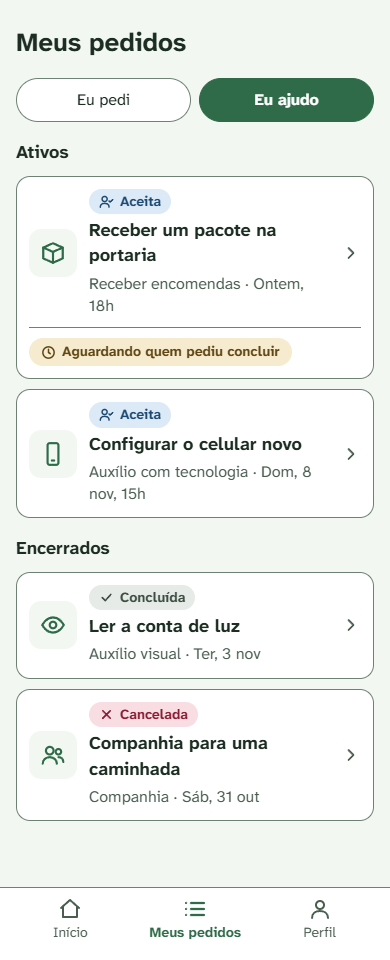
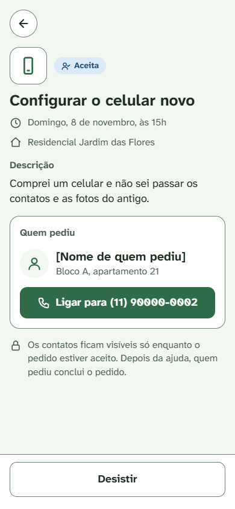
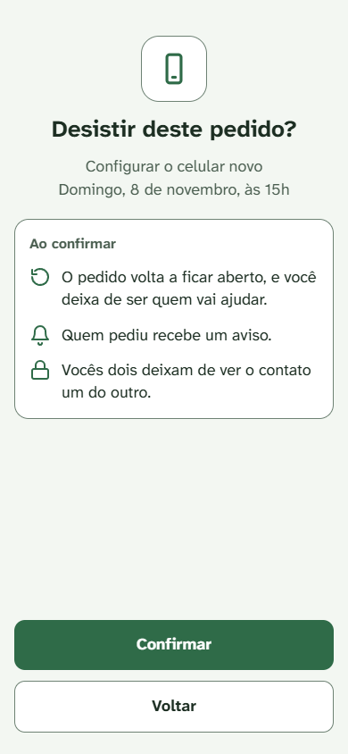
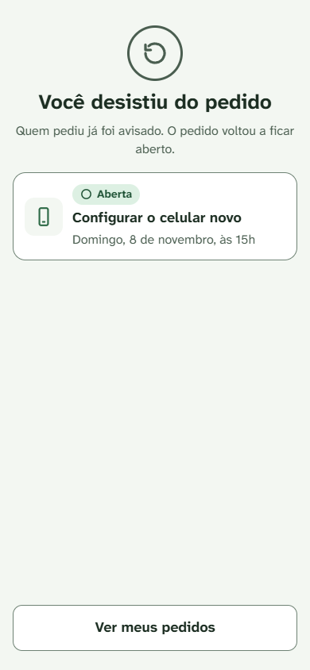
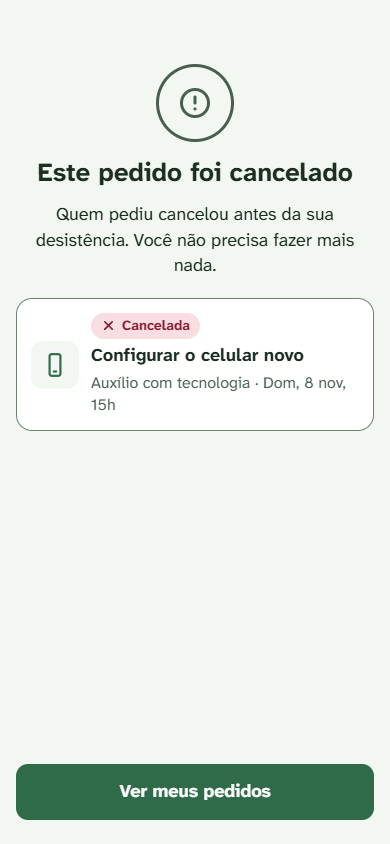
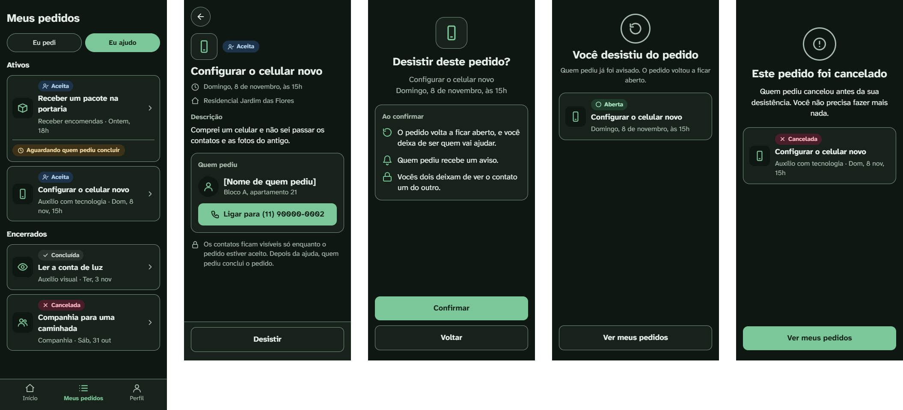

# Mockups: Eu ajudo e desistir

- Origem: Issue #45. Telas do lado de quem ajuda: Meus pedidos (aba "Eu ajudo"), o pedido que vou ajudar e desistir (UC-03), com o rótulo do apoiador (DC-04).
- Ferramenta: tipo Design do Claude.ai, quadro "EntreNós — mockups do apoiador". Esta pasta guarda as imagens da versão aprovada em 06/11/2026.
- Fontes: `docs/casos-de-uso/ciclo-da-solicitacao.md` (UC-02, UC-03, UC-05, DC-02, DC-04, DC-08, DC-10), `docs/specs/usabilidade.md`, `docs/design/identidade-visual.md`, `docs/mockups/criar-e-aceitar.md` (DT-01 a DT-08) e `docs/mockups/meus-pedidos.md` (DT-09 a DT-17).
- Tamanho das telas: 390 px de largura. A tela 1 tem 960 px de altura, para mostrar a lista inteira. A largura de 320 px (RNF-US-06) é conferida na tela real.
- Todo nome entre colchetes, como [Nome de quem pediu], marca onde entra o nome real. A comunidade e os contatos das telas são fictícios.

## Telas

| # | Tela | Caso de uso | Cláusulas e decisões |
|---|---|---|---|
| 1 | Meus pedidos, aba "Eu ajudo" | UC-05 A2 (rótulo do apoiador); RF12 (histórico) | DC-04 (rótulo); RC-10 (lista sem contato de ninguém); RU-05 (status com ícone e palavra); DT-09, DT-10, DT-18, DT-19, DT-23 |
| 2 | Pedido que vou ajudar | UC-02, passo 8 (lado do apoiador); UC-03, passos 1 e 2 | P-04, DC-08 e RC-10 (contato de quem pediu); DC-10 (só enquanto Aceita); RF22 (comunidade); DC-04 (variação com o horário passado, só em texto); DT-20, DT-21, DT-22, DT-23 |
| 3 | Confirmar a desistência | UC-03, passo 2 | DC-10; DT-12, DT-15, DT-21 |
| 4 | Você desistiu do pedido | UC-03, passos 3 a 6; A2 | DC-02 (sem afirmar novo aviso aos vizinhos); DC-10 |
| 5 | Este pedido foi cancelado | UC-03, E1 | Modelo para as recusas sem tela própria |
| 6 | Tema escuro | As telas 1 a 5 | RNF-US-03, RNF-US-04 (V2 da identidade visual) |

A tela 7 de `docs/mockups/criar-e-aceitar.md` ("Você aceitou o pedido") continua como aviso logo depois do aceite e não muda (DT-20).

### 1. Meus pedidos, aba Eu ajudo

### 2. Pedido que vou ajudar

### 3. Confirmar a desistência

### 4. Você desistiu do pedido

### 5. Este pedido foi cancelado

### 6. Tema escuro

## Contagem de toques

O RNF-US-01 e o RNF-US-02 só põem limite em criar e em aceitar. A contagem abaixo fica registrada para comparação. Ela segue as DEF-US-01 a DEF-US-03: começa na tela inicial, com a comunidade escolhida. O fim é o toque em Confirmar, por analogia à DEF-US-04.

| Fluxo | Toques | Caminho |
|---|---|---|
| Desistir | 5 | 1. Meus pedidos (barra) · 2. Eu ajudo (aba) · 3. O pedido (tela 1) · 4. Desistir (tela 2) · 5. Confirmar (tela 3) |

## Conferência contra a spec de usabilidade e a identidade visual

| Cláusula ou regra | Situação no mockup | Como foi conferido |
|---|---|---|
| RNF-US-03, RNF-US-04, RU-07 | Atendido | Todas as cores vêm de `docs/design/identidade-visual.md`. Selos e cor de aviso usam os pares já calculados na tabela de contraste da identidade. Nenhuma cor nova |
| RNF-US-07 | Atendido | Abas com 44 px; cartões da lista com mais de 44 px de altura; itens da barra de navegação com 52 px (DT-05); botões de rodapé com 56 px; Ligar com 52 px; voltar com 44 × 44 px |
| RU-03, RU-04 | Atendido | O vermelho só aparece no selo Cancelada. Desistir usa o botão neutro (DT-21) |
| RU-05 | Atendido | Todo selo e todo rótulo têm ícone e palavra |
| RU-06 | Atendido | Selos e rótulos usam só as cores da tabela "Cores de status" |
| RNF-US-08, RNF-US-10 | Não se aplica | Estas telas não têm formulário |
| RNF-US-05, RNF-US-06, RNF-US-09, RNF-US-11 | Pendente | Zoom de 200%, 320 px, leitor de tela e teclado, na tela real |
| RNF-US-12 | Não se aplica | Mensagens do bot ficam no catálogo |

## Textos das telas

Os casos de uso deixaram os textos para os mockups. Estes são os textos aprovados para as telas acima.

| Onde | Texto |
|---|---|
| Tela 1 | "Meus pedidos" · abas "Eu pedi" e "Eu ajudo" · seções "Ativos" e "Encerrados" |
| Tela 1, rótulo | "Aguardando quem pediu concluir" (Aceita com o horário já passado, DC-04), no rodapé do cartão (DT-23) |
| Tela 2 | "Descrição" · "Quem pediu" · "Ligar para [número]" · "Os contatos ficam visíveis só enquanto o pedido estiver aceito. Depois da ajuda, quem pediu conclui o pedido." · botão "Desistir" |
| Tela 2, horário passado (DC-04) | Rótulo "Aguardando quem pediu concluir" abaixo do selo · "Os contatos ficam visíveis só enquanto o pedido estiver aceito. Quem pediu precisa concluir o pedido." · botão "Desistir" (DT-22) |
| Tela 3 | "Desistir deste pedido?" · "Ao confirmar" · "O pedido volta a ficar aberto, e você deixa de ser quem vai ajudar." · "Quem pediu recebe um aviso." · "Vocês dois deixam de ver o contato um do outro." · botões "Confirmar" e "Voltar" |
| Tela 4 | "Você desistiu do pedido" · "Quem pediu já foi avisado. O pedido voltou a ficar aberto." · botão "Ver meus pedidos" |
| Tela 5, UC-03 E1 (cancelado) | "Este pedido foi cancelado" · "Quem pediu cancelou antes da sua desistência. Você não precisa fazer mais nada." · botão "Ver meus pedidos" |

A tela 4 não diz que os vizinhos foram avisados de novo: depois do horário, a DC-02 não avisa ninguém, e a DC-03 tira o pedido da lista. O aviso a quem pediu sempre acontece (UC-03, passo 4).

Exceções sem tela própria. Elas usam a mesma estrutura da tela 5 (ícone de exclamação em cinza, título, texto, cartão do pedido com o selo do status atual e um botão):

| Exceção | Texto proposto | Botão |
|---|---|---|
| UC-03 E1 (pedido já Concluída) | "Este pedido foi concluído" · "Quem pediu concluiu antes da sua desistência. Você não precisa fazer mais nada." (selo Concluída no cartão) | Ver meus pedidos |
| UC-03 E1 (a pessoa já tinha desistido por outro canal, e o pedido está Aberta) | "Você já tinha desistido deste pedido" · "A desistência já foi registrada. Você não precisa fazer mais nada." (selo Aberta no cartão) | Ver meus pedidos |
| UC-03 E2 (a pessoa já tinha desistido por outro canal, e outro vizinho aceitou) | "Este pedido não está mais com você" · "Outro vizinho aceitou depois da sua desistência. Você não precisa fazer mais nada." (selo Aceita no cartão, sem nenhum contato, P-04) | Ver meus pedidos |

Pelo webapp, a E1 e a E2 do UC-03 só acontecem quando a situação muda entre a abertura da tela 2 e o Confirmar: quem pediu cancelou ou concluiu, ou a própria pessoa desistiu pelo bot (e, na E2, outro vizinho aceitou depois). O botão Desistir só aparece para quem é o apoiador no momento em que a tela abre.

## Decisões de tela

| ID | Decisão | Por quê |
|---|---|---|
| DT-18 | O rótulo do apoiador é "Aguardando quem pediu concluir" (antes, o exemplo era "Aguardando confirmação do solicitante") | As telas dizem "quem pediu", nunca "solicitante" (DT-02). Usa a mesma palavra do botão Concluir, como a DT-13 |
| DT-19 | Pedidos dos quais a pessoa desistiu não aparecem em "Eu ajudo" | Depois de desistir, ela não é mais apoiadora (RC-03) e não vê mais o contato (DC-10). Mostrar exigiria ler o histórico de transições, uma regra a mais sem RF. Pedidos Concluída e Cancelada vindos de Aceita continuam em "Eu ajudo", porque o apoiador só deixa de existir na desistência (RC-03) |
| DT-20 | O pedido que vou ajudar tem tela própria. A tela 7 dos mockups de criar e aceitar continua só como aviso logo depois do aceite | O UC-03 começa abrindo o pedido aceito pela lista. Assim o PR #39 não muda |
| DT-21 | Desistir usa o botão neutro. A confirmação é tela inteira, com Confirmar no botão principal | Mesmo padrão de cancelar (DT-11, DT-12, DT-15) |
| DT-22 | O apoiador não tem botão Concluir. Depois do horário, vê o rótulo e "Quem pediu precisa concluir o pedido." | Só quem pediu conclui (UC-05 E3) |
| DT-23 | O rótulo do apoiador fica no rodapé do cartão, abaixo de uma linha, e não ao lado do selo. No detalhe (tela 2), ele fica abaixo do selo | O texto é longo e quebraria em duas linhas ao lado do selo. Segue o mesmo padrão do cartão com o rótulo de horário vencido em `docs/mockups/meus-pedidos.md` |
| DT-24 | A barra de navegação (DT-05) só aparece nas telas principais: Início, Meus pedidos e Perfil. Detalhes, confirmações e telas de resultado ficam sem a barra e têm o botão Voltar ou um botão que leva de volta | É o padrão que já existe nos mockups de criar e aceitar e nos do solicitante. Numa confirmação, a barra seria uma saída a mais no meio de uma decisão, e no detalhe ela tiraria espaço do conteúdo |

## Pendências

- Desistir pelo bot: catálogo de mensagens do bot.
- Linha da categoria por escrito no detalhe do pedido aceito (tela 2 daqui e tela 3 de `docs/mockups/meus-pedidos.md`), como na tela 5 de `docs/mockups/criar-e-aceitar.md` ⚠️ (opcional).
- Tela de Perfil (inclui marcar "Outra ajuda" entre as ajudas oferecidas).
- Abas no código: componente com as teclas de seta do teclado ⚠️ (RNF-US-11).
- Conferir na tela real os RNF-US-05, RNF-US-06, RNF-US-09 e RNF-US-11, e o foco do teclado (RU-01).
