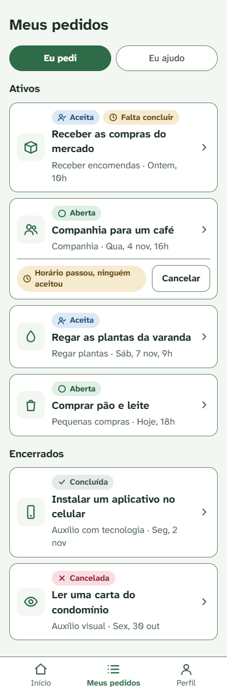
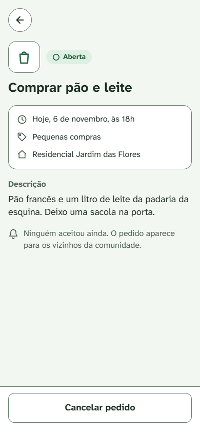
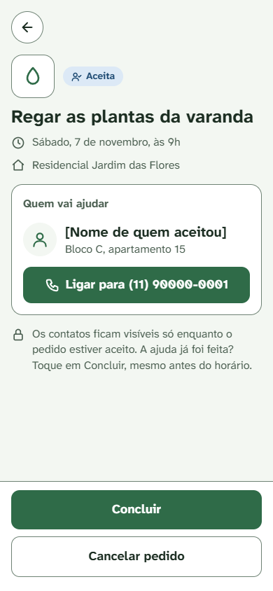
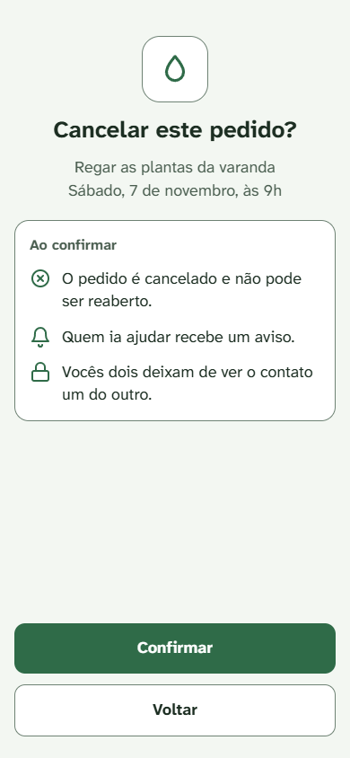
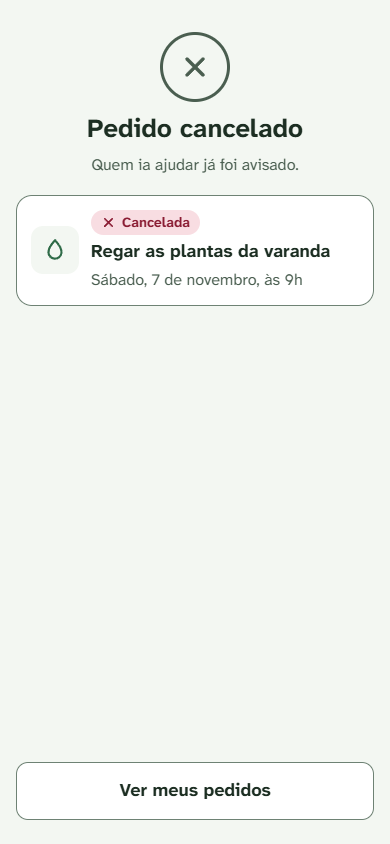
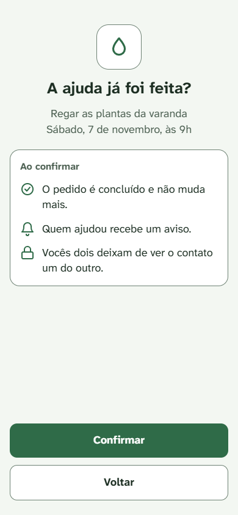
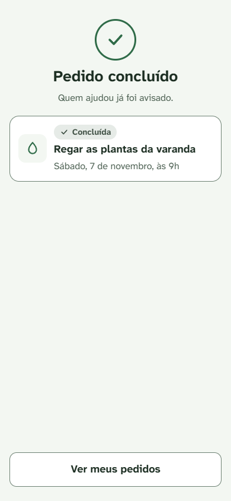
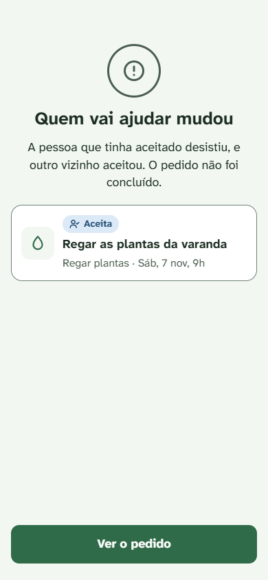
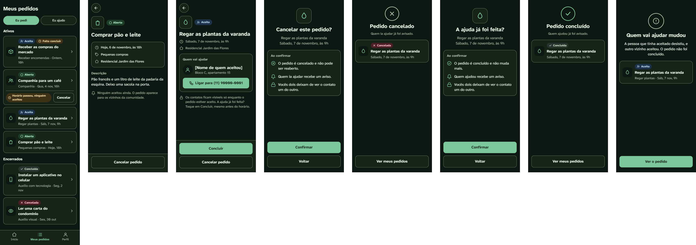

# Mockups: Meus pedidos, cancelar e concluir

- Origem: Issue #43. Telas do lado de quem pede: Meus pedidos (aba "Eu pedi"), o próprio pedido Aberta e Aceita, cancelar (UC-04) e concluir (UC-05), com os rótulos de exibição (DC-03, DC-04).
- Ferramenta: tipo Design do Claude.ai, quadro "EntreNós — mockups do solicitante". Esta pasta guarda as imagens da versão aprovada em 06/11/2026.
- Fontes: `docs/casos-de-uso/ciclo-da-solicitacao.md` (UC-02 a UC-05, DC-03, DC-04, DC-09 a DC-12), `docs/specs/usabilidade.md`, `docs/design/identidade-visual.md` e `docs/mockups/criar-e-aceitar.md` (DT-01 a DT-08).
- Tamanho das telas: 390 px de largura. A tela 1 tem 1200 px de altura, para mostrar a lista inteira. A largura de 320 px (RNF-US-06) é conferida na tela real.
- Todo nome entre colchetes, como [Nome de quem aceitou], marca onde entra o nome real. A comunidade e os contatos das telas são fictícios.

## Telas

| # | Tela | Caso de uso | Cláusulas e decisões |
|---|---|---|---|
| 1 | Meus pedidos, aba "Eu pedi" | UC-04 A3 (Cancelar ao lado do rótulo); UC-05 A2 (rótulo); RF12 (histórico) | DC-03 e DC-04 (rótulos); RC-10 e RC-12 (lista sem contato de ninguém); RU-05 (status com ícone e palavra); DT-09, DT-10, DT-13 |
| 2 | Meu pedido Aberta | UC-04, passos 1 e 2 | DT-11 (Cancelar neutro); DC-03 (variação com o horário passado, só em texto) |
| 3 | Meu pedido Aceita | UC-02, passo 8 (lado do solicitante); UC-04 e UC-05, passos 1 e 2 | DC-09 e RC-12 (contato do apoiador); DC-10 (só enquanto Aceita); DC-11 (Concluir antes do horário); DC-04 (variação com o horário passado, só em texto); RF22 (comunidade); DT-11, DT-16 |
| 4 | Confirmar o cancelamento | UC-04, passo 2; A5 (Voltar) | DC-10; DT-12, DT-14, DT-15, DT-17 |
| 5 | Pedido cancelado | UC-04, passos 3 e 4; A4 | RU-04 (vermelho só no selo); DC-10 |
| 6 | Confirmar a conclusão | UC-05, passo 2; A4 (Voltar) | DC-12 (confirmação no webapp); DC-10; DT-12, DT-15 |
| 7 | Pedido concluído | UC-05, passos 3 e 4 | D-01 e RC-11 (sem avaliação); DC-10 |
| 8 | Quem vai ajudar mudou | UC-05, E4 | Selo Aceita no cartão (o pedido continua Aceita); modelo para as recusas sem tela própria |
| 9 | Tema escuro | As telas 1 a 8 | RNF-US-03, RNF-US-04 (V2 da identidade visual) |

### 1. Meus pedidos

### 2. Meu pedido Aberta

### 3. Meu pedido Aceita

### 4. Confirmar o cancelamento

### 5. Pedido cancelado

### 6. Confirmar a conclusão

### 7. Pedido concluído

### 8. Quem vai ajudar mudou

### 9. Tema escuro

## Contagem de toques

O RNF-US-01 e o RNF-US-02 só põem limite em criar e em aceitar. A contagem abaixo fica registrada para comparação. Ela segue as DEF-US-01 a DEF-US-03: começa na tela inicial, com a comunidade escolhida, e o primeiro toque é "Meus pedidos" na barra de navegação. O fim é o toque em Confirmar, por analogia à DEF-US-04, que só define o fim para publicar e aceitar.

| Fluxo | Toques | Caminho |
|---|---|---|
| Cancelar, pelo detalhe | 4 | 1. Meus pedidos (barra) · 2. O pedido (tela 1) · 3. Cancelar pedido (tela 2 ou 3) · 4. Confirmar (tela 4) |
| Cancelar, pelo rótulo de horário vencido | 3 | 1. Meus pedidos (barra) · 2. Cancelar, no cartão (tela 1) · 3. Confirmar (tela 4) |
| Concluir | 4 | 1. Meus pedidos (barra) · 2. O pedido (tela 1) · 3. Concluir (tela 3) · 4. Confirmar (tela 6) |

## Conferência contra a spec de usabilidade e a identidade visual

| Cláusula ou regra | Situação no mockup | Como foi conferido |
|---|---|---|
| RNF-US-03, RNF-US-04, RU-07 | Atendido | Todas as cores vêm de `docs/design/identidade-visual.md`. Os selos (Aberta, Aceita, Concluída, Cancelada) e a cor de aviso usam os pares já calculados na tabela de contraste da identidade. Nenhuma cor nova |
| RNF-US-07 | Atendido | Abas com 44 px; botão Cancelar do cartão com 44 px; cartões da lista com mais de 44 px de altura; itens da barra de navegação com 52 px (DT-05); botões de rodapé com 56 px; Ligar com 52 px; voltar com 44 × 44 px |
| RU-03, RU-04 | Atendido | O vermelho só aparece no selo Cancelada. O X da tela 5 é cinza. Cancelar usa o botão neutro (DT-11) |
| RU-05 | Atendido | Todo selo e todo rótulo têm ícone e palavra |
| RU-06 | Atendido | Selos e rótulos usam só as cores da tabela "Cores de status" |
| RNF-US-08, RNF-US-10 | Não se aplica | Estas telas não têm formulário |
| RNF-US-05, RNF-US-06, RNF-US-09, RNF-US-11 | Pendente | Zoom de 200%, 320 px, leitor de tela e teclado, na tela real |
| RNF-US-12 | Não se aplica | Mensagens do bot ficam no catálogo |

## Textos das telas

Os casos de uso deixaram os textos para os mockups. Estes são os textos aprovados para as telas acima.

| Onde | Texto |
|---|---|
| Tela 1 | "Meus pedidos" · abas "Eu pedi" e "Eu ajudo" · seções "Ativos" e "Encerrados" |
| Tela 1, rótulos | "Falta concluir" (Aceita com o horário já passado, DC-04) · "Horário passou, ninguém aceitou" (Aberta com o horário já passado, DC-03), com o botão "Cancelar" no cartão |
| Tela 2 | "Ninguém aceitou ainda. O pedido aparece para os vizinhos da comunidade." · botão "Cancelar pedido" |
| Tela 2, horário passado (DC-03) | Rótulo "Horário passou, ninguém aceitou" ao lado do selo · aviso "O horário passou e ninguém aceitou. Você pode cancelar o pedido." · botão "Cancelar pedido" |
| Tela 3 | "Quem vai ajudar" · "Ligar para [número]" · "Os contatos ficam visíveis só enquanto o pedido estiver aceito. A ajuda já foi feita? Toque em Concluir, mesmo antes do horário." · botões "Concluir" e "Cancelar pedido" |
| Tela 3, horário passado (DC-04) | Rótulo "Falta concluir" ao lado do selo · "Os contatos ficam visíveis só enquanto o pedido estiver aceito. A ajuda já foi feita? Toque em Concluir." · botões "Concluir" e "Cancelar pedido" |
| Tela 4 | "Cancelar este pedido?" · "Ao confirmar" · "O pedido é cancelado e não pode ser reaberto." · "Quem ia ajudar recebe um aviso." · "Vocês dois deixam de ver o contato um do outro." · botões "Confirmar" e "Voltar" |
| Tela 4, pedido Aberta | Só a primeira linha: "O pedido é cancelado e não pode ser reaberto." (DT-17) |
| Tela 5 | "Pedido cancelado" · "Quem ia ajudar já foi avisado." (só quando havia apoiador, inclusive no UC-04 A4) · botão "Ver meus pedidos" |
| Tela 6 | "A ajuda já foi feita?" · "Ao confirmar" · "O pedido é concluído e não muda mais." · "Quem ajudou recebe um aviso." · "Vocês dois deixam de ver o contato um do outro." · botões "Confirmar" e "Voltar" |
| Tela 7 | "Pedido concluído" · "Quem ajudou já foi avisado." · botão "Ver meus pedidos" |
| Tela 8, UC-05 E4 | "Quem vai ajudar mudou" · "A pessoa que tinha aceitado desistiu, e outro vizinho aceitou. O pedido não foi concluído." · botão "Ver o pedido" |

Exceções sem tela própria. Elas usam a mesma estrutura da tela 8 (ícone de exclamação em cinza, título, texto, cartão do pedido com o selo do status atual e um botão):

| Exceção | Texto proposto | Botão |
|---|---|---|
| UC-04 E1 e UC-05 E2 (pedido já Concluída) | "Este pedido foi concluído" (título; selo Concluída no cartão) | Ver meus pedidos |
| UC-04 E1 e UC-05 E2 (pedido já Cancelada) | "Este pedido foi cancelado" (título; selo Cancelada no cartão) | Ver meus pedidos |
| UC-05 E1 (o pedido voltou a Aberta) | "Quem tinha aceitado desistiu. O pedido voltou a ficar aberto e não foi concluído." (selo Aberta no cartão) | Ver o pedido |

No webapp, a E1 do UC-05 só acontece quando o apoiador desiste entre a abertura da tela 3 e o Confirmar. Por isso o texto fala da desistência.

A E2 do UC-04 e a E3 do UC-05 (o morador não é o solicitante) não acontecem por estas telas: os botões Cancelar e Concluir só aparecem para quem pediu. Elas valem para o bot e para chamadas diretas, e a resposta é tratada na spec.

## Decisões de tela

| ID | Decisão | Por quê |
|---|---|---|
| DT-09 | Abas "Eu pedi" e "Eu ajudo" em Meus pedidos | São curtas. "Eu ajudo" vale tanto para o que a pessoa vai fazer quanto para o histórico do que já fez |
| DT-10 | Ativos (Aberta e Aceita) em cima e Encerrados (Concluída e Cancelada) embaixo. Dentro de Ativos, primeiro os pedidos com rótulo | O que pede ação fica à vista, e o histórico (RF12) continua na mesma tela |
| DT-11 | Cancelar usa o botão neutro (contorno), no detalhe e no cartão. Concluir usa o botão principal | A RU-03 e a RU-04 reservam o vermelho para erro de campo e para o selo Cancelada |
| DT-12 | As confirmações de cancelar e de concluir são telas inteiras | Mesmo motivo da DT-01 |
| DT-13 | O rótulo do solicitante é "Falta concluir" (antes, o exemplo era "Aguardando sua confirmação") | Usa a mesma palavra do botão Concluir |
| DT-14 | A confirmação de cancelar um pedido Aceita avisa que quem ia ajudar recebe um aviso e que os contatos somem | DC-10. Quem cancela fica sabendo, antes, o que acontece com o outro lado |
| DT-15 | Nas confirmações, o botão Confirmar usa o principal, também ao cancelar | Dois botões neutros ficariam iguais, e não daria para ver qual confirma. A pergunta e as linhas de "Ao confirmar" dizem o que acontece |
| DT-16 | O botão Ligar repete o da tela 7 dos mockups de criar e aceitar (principal), mesmo com Concluir também verde na tela 3 | O par de cores já está calculado. Um Ligar só com contorno verde usaria um par que não está na tabela da identidade visual (RU-07) |
| DT-17 | Cancelar um pedido Aberta usa a tela 4 só com a primeira linha | Sem apoiador, não há quem avisar nem contato a esconder |

## Pendências

- Aba "Eu ajudo", desistir e o rótulo do apoiador: `docs/mockups/eu-ajudo.md` (Issue #45).
- Cancelar e concluir pelo bot: catálogo de mensagens do bot e Issue #42.
- Tela de Perfil (inclui marcar "Outra ajuda" entre as ajudas oferecidas).
- Abas no código: componente com as teclas de seta do teclado ⚠️ (RNF-US-11).
- Conferir na tela real os RNF-US-05, RNF-US-06, RNF-US-09 e RNF-US-11, e o foco do teclado (RU-01).
