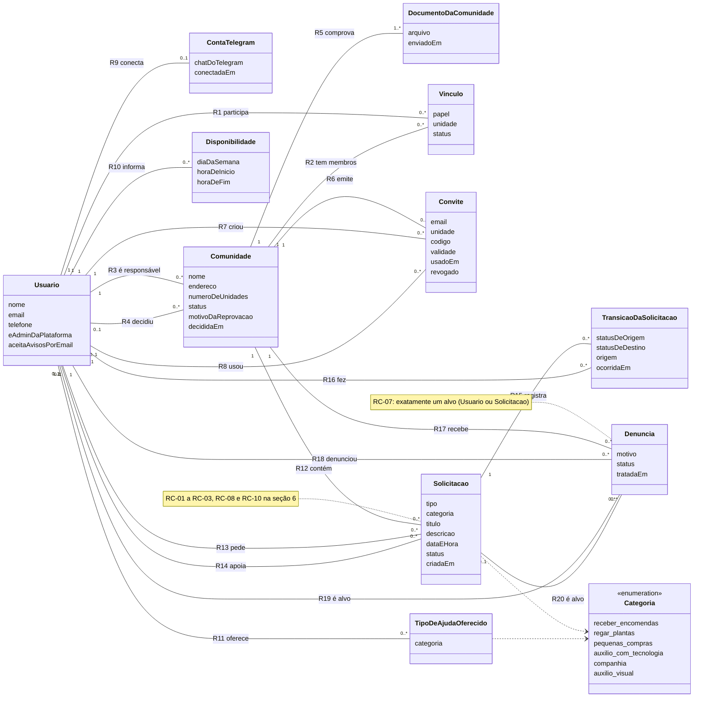

# Modelo de domínio conceitual — EntreNós

| Campo | Valor |
|---|---|
| Nível | **Conceitual** (aula 4): só conceitos e relacionamentos. Sem identificadores técnicos, tipos de dado ou nomes de tabela. Isso fica no nível físico (as migrations). |
| Data | 05/11/2026 |
| Situação | Primeira versão. Base para os casos de uso, as specs dos RFs e as próximas migrations. |
| Fontes | `docs/constitution.md` (P-01 a P-08) · requisitos RF01 a RF24 e RNF01 a RNF08 (RF24, aviso por e-mail, entrou junto com este modelo) · decisões ADR-08 a ADR-14, ADR-20 |
| Fora deste modelo | Tabelas técnicas de infraestrutura (a do cron anti-pausa e a da idempotência do webhook): não são conceitos do domínio. |

---

## 1. Objetivo

Descrever as entidades do EntreNós e como elas se ligam, antes de pensar em banco ou código. Cada relacionamento tem multiplicidade e uma frase explicando o que ele significa.

---

## 2. Decisões que moldam o modelo

| ID | Decisão | Por quê | Alternativa descartada |
|---|---|---|---|
| MD-01 | Disponibilidade e tipos de ajuda oferecidos ficam no **Usuário**, não no Vínculo. | A pessoa tem um só horário de vida. Cadastro e regra de aviso ficam mais simples. | No Vínculo: permitiria ajudar numa comunidade e não em outra, com mais telas e mais regra. |
| MD-02 | Uma comunidade pode ter **mais de um admin**. | O papel fica no Vínculo; o modelo já permite vários. Proibir exigiria uma regra a mais. | Um admin só. |
| MD-03 | A **unidade é informada pelo admin no convite** e passa para o Vínculo no cadastro. | O admin sabe quem mora onde. O morador não consegue se declarar em outra unidade. | O morador informa a unidade no cadastro. |
| MD-04 | **Conectar o Telegram é opcional** para as ajudas comuns e **obrigatório para o Olhar Amigo**, nos dois lados. Quem não tem Telegram recebe os avisos **por e-mail**, se aceitar recebê-los. | O público inclui pessoas que usam e-mail e não usam Telegram; sem outro canal, elas nunca seriam avisadas. O e-mail já existe no cadastro e já é usado no convite (ADR-09). A videochamada do Olhar Amigo acontece no Telegram (ADR-20), e e-mail é lento demais para uma ajuda imediata. | (a) Telegram obrigatório para todos: excluiria quem não usa o aplicativo. (b) Telegram opcional, sem outro canal: quem não tem Telegram ficaria sem avisos. |
| MD-05 | A **suspensão é do Vínculo**, não da pessoa. Um usuário suspenso numa comunidade continua operando nas outras. Quando a constituição fala em "usuário suspenso" (P-07) ou "usuário ativo" (P-05), lê-se "vínculo suspenso" ou "vínculo ativo" naquela comunidade. | Quem suspende é o admin da comunidade (RF17), e ele só tem poder sobre a própria comunidade. | Status no Usuário (suspensão em todas as comunidades): exigiria um papel com poder sobre todas as comunidades, que nenhum RF prevê. |

---

## 3. Entidades e atributos

| Entidade | Atributos | O que é |
|---|---|---|
| **Usuário** | nome, e-mail, telefone, é admin da plataforma, aceita avisos por e-mail | Pessoa cadastrada. Pode estar em várias comunidades. O último atributo deixa a pessoa desligar os avisos por e-mail (MD-04, RNF04). |
| **Conta do Telegram** | chat do Telegram, data da conexão | Ligação entre o usuário e o chat dele com o bot (RF23). |
| **Comunidade** | nome, endereço, número de unidades, status, motivo da reprovação, data da decisão | Condomínio ou prédio cadastrado. Só opera depois de aprovada (P-07). |
| **Documento da comunidade** | arquivo, data de envio | Comprovante enviado no cadastro da comunidade (ADR-12). |
| **Vínculo** | papel, unidade, status | Participação de um usuário numa comunidade. É a base do isolamento por comunidade (P-03). |
| **Convite** | e-mail, unidade, código, validade, data de uso, revogado | Convite pessoal, de uso único, válido por 7 dias (ADR-09). |
| **Disponibilidade** | dia da semana, hora de início, hora de fim | Quando o usuário pode ajudar (RF03). |
| **Tipo de ajuda oferecido** | categoria | Que tipos de ajuda o usuário aceita fazer (RF03). |
| **Solicitação** | tipo, categoria, título, descrição, data e hora, status, data de criação | Pedido de ajuda de um morador (RF04). As datas de cada mudança de status ficam na Transição, para não guardar a mesma data em dois lugares. |
| **Transição da solicitação** | status de origem, status de destino, origem, data | Registro de cada mudança de status: quem fez, quando e por onde. |
| **Denúncia** | motivo, status, data do tratamento | Queixa sobre um usuário ou uma solicitação (RF16, ADR-13). |

---

## 4. Valores fixos

Estes conceitos são listas fechadas de valores, não entidades.

| Conceito | Valores |
|---|---|
| Categoria | receber encomendas · regar plantas · pequenas compras · auxílio com tecnologia · companhia · auxílio visual |
| Tipo de solicitação | normal · Olhar Amigo |
| Status da solicitação | aberta · aceita · concluída · cancelada |
| Status da comunidade | pendente · ativa (é a comunidade "aprovada" da P-07) · reprovada |
| Papel no vínculo | morador · admin |
| Status do vínculo | ativo · suspenso · removido |
| Origem da transição | webapp · bot |
| Status da denúncia | aberta · tratada |

As transições válidas de status da solicitação estão na máquina de estados (P-02). Este modelo não as repete.

No diagrama, só Categoria aparece como lista, porque é usada por duas entidades (Solicitação e Tipo de ajuda oferecido). As outras listas são usadas por um atributo só e ficam nesta tabela.

---

## 5. Relacionamentos

A multiplicidade se lê nos dois sentidos. Exemplo: R1 "1 — 0..N" quer dizer que cada vínculo pertence a exatamente um usuário, e cada usuário tem de zero a N vínculos.

| # | Relacionamento | Multiplicidade | O que significa |
|---|---|---|---|
| R1 | Usuário — Vínculo | 1 — 0..N | Um usuário pode estar em várias comunidades (ADR-10). |
| R2 | Comunidade — Vínculo | 1 — 0..N | Uma comunidade tem vários membros. |
| R3 | Usuário (responsável) — Comunidade | 1 — 0..N | Quem pediu o cadastro da comunidade. |
| R4 | Usuário (quem decidiu) — Comunidade | 0..1 — 0..N | O admin da plataforma que aprovou ou reprovou. Vazio enquanto a comunidade está pendente. |
| R5 | Comunidade — Documento da comunidade | 1 — 1..N | Toda comunidade é cadastrada com pelo menos um documento. |
| R6 | Comunidade — Convite | 1 — 0..N | Todo convite é para uma comunidade só. |
| R7 | Usuário (quem criou) — Convite | 1 — 0..N | O admin da comunidade que enviou o convite. |
| R8 | Usuário (quem usou) — Convite | 0..1 — 0..N | Uso único: um convite é usado por no máximo uma pessoa. Uma pessoa pode usar vários convites, um para cada comunidade em que entra (ADR-10). |
| R9 | Usuário — Conta do Telegram | 1 — 0..1 | Conectar o Telegram é opcional (MD-04). |
| R10 | Usuário — Disponibilidade | 1 — 0..N | Os horários em que o usuário pode ajudar (MD-01). |
| R11 | Usuário — Tipo de ajuda oferecido | 1 — 0..N | Os tipos de ajuda que o usuário aceita fazer (MD-01). |
| R12 | Comunidade — Solicitação | 1 — 0..N | Toda solicitação pertence a uma comunidade. |
| R13 | Usuário (solicitante) — Solicitação | 1 — 0..N | Quem pediu a ajuda. |
| R14 | Usuário (apoiador) — Solicitação | 0..1 — 0..N | Quem aceitou a ajuda. Só existe a partir da aceitação. |
| R15 | Solicitação — Transição da solicitação | 1 — 0..N | O histórico de mudanças de status da solicitação. |
| R16 | Usuário (autor) — Transição da solicitação | 1 — 0..N | Quem fez cada mudança de status. |
| R17 | Comunidade — Denúncia | 1 — 0..N | A denúncia é tratada pelo admin daquela comunidade. |
| R18 | Usuário (denunciante) — Denúncia | 1 — 0..N | Quem fez a denúncia. |
| R19 | Usuário (alvo) — Denúncia | 0..1 — 0..N | O usuário denunciado, quando o alvo é uma pessoa. |
| R20 | Solicitação (alvo) — Denúncia | 0..1 — 0..N | A solicitação denunciada, quando o alvo é um pedido. |

---

## 6. Restrições do modelo

Regras que o diagrama sozinho não mostra. Cada uma vai virar cláusula (RB) nas specs correspondentes.

| ID | Restrição | Origem |
|---|---|---|
| RC-01 | O solicitante e o apoiador têm vínculo **ativo** (não suspenso, MD-05) na comunidade da solicitação. | P-03, P-07 |
| RC-02 | O solicitante nunca é o apoiador da própria solicitação. | P-02 |
| RC-03 | O apoiador só existe a partir da aceitação. Quando o apoiador desiste (Aceita → Aberta), a solicitação volta a não ter apoiador. | P-02 |
| RC-04 | Um usuário tem no máximo um vínculo por comunidade. | ADR-10 |
| RC-05 | Um convite é usado no máximo uma vez, vale 7 dias e só serve para comunidade ativa. | P-07, ADR-09 |
| RC-06 | Comunidade pendente ou reprovada não recebe membros nem solicitações. | P-07 |
| RC-07 | Toda denúncia tem **exatamente um** alvo: um usuário **ou** uma solicitação. | RF16 |
| RC-08 | Solicitação do tipo Olhar Amigo exige Conta do Telegram do solicitante e do apoiador. | MD-04, ADR-20 |
| RC-09 | Quem tem Conta do Telegram recebe os avisos pelo Telegram. Quem não tem e aceita avisos por e-mail recebe por e-mail. Quem não tem nenhum dos dois não recebe aviso e acompanha pelo webapp. | MD-04, RF07, RF24 |
| RC-10 | Unidade e telefone do solicitante só são visíveis ao apoiador que aceitou e nunca aparecem em listagens. | P-04 |
| RC-11 | Não existe avaliação entre moradores. O único registro sobre a conduta de alguém é a denúncia. | D-01, ADR-13 |

---

## 7. Diagrama

---

## 8. Pontos em aberto ⚠️

Não mudam a estrutura do modelo, mas mudam regras. Serão resolvidos nos casos de uso e nas specs.

- O vínculo de admin do responsável é criado só na aprovação da comunidade?
- Comunidade reprovada pode reenviar o pedido e voltar a pendente?
- O e-mail do convite precisa ser igual ao e-mail do cadastro?
- Como um usuário que já tem conta usa um convite para entrar em outra comunidade?
- Quais são os efeitos da suspensão do vínculo?
- Exclusão de conta (LGPD): apagar ou anonimizar?
- O telefone continua obrigatório no cadastro?
- Alinhar o texto da P-05 e da P-07 na constituição com a MD-05 (Issue separada, porque mexe na constituição).
